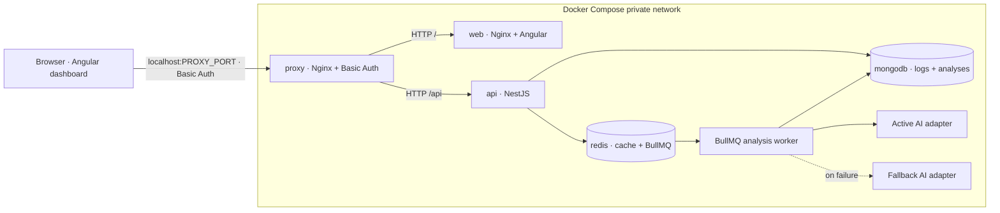

# SmartLog Analyzer — Architecture

## Scope and implementation status

SmartLog Analyzer is a pnpm monorepo for collecting microservice logs, reviewing them with a configurable external AI provider, and tracking asynchronous analysis jobs.

Implemented in this prototype:

- NestJS API with DTO validation, consistent HTTP errors, Swagger, MongoDB persistence through TypeORM, Redis-backed Nest cache, and BullMQ analysis queues.
- Provider-agnostic AI contract, native OpenAI Chat Completions, Anthropic Messages, and Gemini `generateContent` adapters, active-provider selection, fallback, health probe, retry/backoff, and dead-letter queue.
- Angular dashboard for log ingestion, selection, AI job status polling, completed insights, and failure status.
- Unit, HTTP integration, and Angular tests live under the root `tests/` directory.

External AI requests require provider endpoints and credentials in `.env`. The sample keys/passwords are placeholders. Without a reachable active provider, the health endpoint reports the provider as down and analysis jobs eventually enter the dead-letter queue after retry exhaustion.

## Monorepo layout

```text
smartlog-analyzer/
├── src/
│   ├── api/                       # NestJS API
│   │   └── src/
│   │       ├── common/            # Shared filters, contracts, validators
│   │       ├── db/                # TypeORM DataSource, migrations, seeds
│   │       └── modules/
│   │           ├── logs/          # Log DTOs, persistence and endpoints
│   │           ├── analyses/      # Analysis jobs, providers and endpoints
│   │           └── health/        # API/dependency/provider health
│   └── web/                       # Angular 19 workspace and dashboard
├── tests/
│   ├── unit/                      # Unit tests for domain/provider/health behavior
│   ├── integration/               # HTTP contract and validation tests
│   └── web/                       # Angular/Karma tests and test tsconfig
├── Dockerfile                     # Multi-stage API, web and proxy images
├── nginx-proxy.conf.template      # Basic-authenticated HTTP ingress
├── docker-compose.yml             # Proxy, API, web, MongoDB and Redis
├── .env.example                   # Placeholder environment values only
├── README.md
└── ARCHITECTURE.md
```

pnpm workspaces are declared in `pnpm-workspace.yaml`. Root scripts are the supported entry point for builds and tests. Test source files are kept out of `src/api` and `src/web`.

## Deployment and request flow



The browser uses one origin: `http://localhost:${PROXY_PORT}` (8080 by default), with Basic Authentication on dashboard and API routes. Nginx routes `/api/` to NestJS and all other paths to the Angular web container. It removes the inbound `Authorization` header before proxying. API and web ports are not published. MongoDB and Redis bind only to `127.0.0.1` for local development; within Compose, services use DNS names (`api`, `web`, `mongodb`, `redis`) and container-specific connection URLs from `*_DOCKER` variables. MongoDB data persists in `mongodb_data`; Redis queue/cache data persists in `redis_data`.

| Service | Container port | Host port | Purpose |
|---|---:|---:|---|
| Reverse proxy | 80 | `PROXY_PORT` (8080 default) | Basic Auth ingress; routes dashboard and API |
| Web / Nginx | 80 | Not published | Angular dashboard |
| API | 3000 | Not published | REST endpoints, health and Swagger |
| MongoDB | 27017 | `127.0.0.1:MONGO_PORT` | Logs and analysis records; local development access |
| Redis | 6379 | `127.0.0.1:REDIS_PORT` | Nest cache and BullMQ queue/DLQ; local development access |

Compose starts API after MongoDB and Redis pass their health checks. The API container health check calls `/api/health/live`, which only verifies that the process answers. Readiness lives at `/api/health`, where dependency or active-provider failures report 503; Compose deliberately does not gate container health on it, so a third-party AI outage cannot mark the container unhealthy.
The proxy starts after API and web containers have started. Basic Auth credentials are read from `.env`; an Apache MD5 (`apr1`) htpasswd file is generated at container startup for Nginx compatibility. Basic Auth over plain HTTP does not encrypt credentials, so deploy behind TLS outside local development.

## HTTP API

All REST routes use the `/api` global prefix. Responses use JSON. Errors have the common shape:

```json
{
  "statusCode": 400,
  "error": "Bad Request",
  "message": "service must be a lowercase slug",
  "path": "/api/logs",
  "timestamp": "2026-11-02T14:00:00.000Z"
}
```

| Method | Route | Success | Behavior |
|---|---|---:|---|
| `POST` | `/api/logs` | 201 | Validate and persist a log |
| `GET` | `/api/logs` | 200 | Filter and paginate logs |
| `POST` | `/api/logs/analyze` | 202 | Validate log ObjectIds and queue an analysis |
| `GET` | `/api/analysis` | 200 | Filter and paginate analysis jobs |
| `GET` | `/api/analysis/{id}` | 200 | Get current status, result or terminal error |
| `GET` | `/api/health` | 200 / 503 | Readiness: HTTP root, MongoDB, Redis-backed cache, active AI provider and memory |
| `GET` | `/api/health/live` | 200 | Liveness: process is running; no dependency checks |
| `GET` | `/api/docs` | 200 | Swagger UI and OpenAPI document |

List endpoints accept `limit` (default 20, maximum 100) and `offset` (default 0). Logs additionally accept `service`, `level`, `from` and `to`; analyses accept `status` (`queued`, `processing`, `completed`, `failed`). `from` must not be later than `to`.

### Input validation and log model

Controllers accept DTOs decorated with `class-validator`; the global Nest `ValidationPipe` transforms inputs, rejects unknown fields, and returns HTTP 400 for invalid input. A service identifier is a lowercase slug matching `^[a-z0-9]+(?:-[a-z0-9]+)*$` and is limited to 63 characters. Timestamps must be ISO date strings. Messages are trimmed, required, and limited to 10,000 characters.

Log levels use NestJS's exported `LOG_LEVELS` and `LogLevel` values; SmartLog does not define a parallel level enum. A log document also includes an ingestion timestamp and optional structured metadata.

Example request:

```json
{
  "service": "payment-api",
  "timestamp": "2026-11-02T14:00:00.000Z",
  "level": "error",
  "message": "Payment authorization timed out",
  "metadata": { "requestId": "request-123" }
}
```

## Persistence: MongoDB and TypeORM

`src/api/src/db/data-source.ts` exports the TypeORM MongoDB `DataSourceOptions` consumed by `TypeOrmModule.forRoot(AppDataSource)`. Entity and migration globs resolve from `__dirname`, not `process.cwd()`, so discovery works both from `src/api` in development and from `/app` in the container where the build output lives under `/app/src/api/dist`. `synchronize` is disabled. The `logs` collection stores validated log events; `analyses` stores requested log IDs, provider, job status, attempts, timestamps, result and terminal error.

The data access is separated into `LogsService` and `AnalysesService` using TypeORM Mongo repositories. Modules expose cross-module collaborators through interfaces and string-free DI tokens: `LogsServiceInterface` is registered under the `LOGS_SERVICE` symbol declared in the `analyses/symbols` barrel, and AI adapters are registered under `ANALYSIS_PROVIDERS`, so consumers depend on contracts rather than concrete classes. Mongo health uses the TypeORM Mongo driver's native `ping` command; the SQL-oriented Terminus TypeORM indicator is not used for a Mongo connection. Index/migration and retention strategy remain future work.

## Redis cache and queues

`AppModule` registers Nest's official `CacheModule` with `isGlobal: true` and the ioredis store adapter configured from `REDIS_URL`; feature modules inject the standard cache manager without custom wrappers. Controllers use Nest's `CacheInterceptor` for the paginated log list, and the health check verifies the cache through the cache manager API. Cache TTL is configured by `CACHE_TTL_SECONDS`. BullMQ configures its own Redis connection from the same URL.

BullMQ uses Redis for:

- `log-analysis`: queued analysis work.
- `log-analysis-dead-letter`: failed jobs after all attempts are exhausted.

`POST /api/logs/analyze` responds immediately with `202 Accepted` and a job ID in `queued` state. The worker changes the persisted status to `processing`, then to `completed` with insights or `failed` with a safe error message. The queue defaults to three attempts with exponential backoff starting at 1,000 ms; use `AI_RETRY_ATTEMPTS` and `AI_RETRY_BACKOFF_MS` to configure the retry policy. On terminal failure, the worker logs the failure and adds a durable dead-letter entry.

## Provider-agnostic AI

`AnalysisProvider` is the domain interface. Native adapters implement `analyze(logs)` and `checkHealth()` for OpenAI Chat Completions, Anthropic Messages, and Gemini `generateContent`. Each requests/reads provider-native JSON content and validates the shared `{summary, insights}` result contract. Unknown provider names can still use the generic HTTP/JSON adapter. The configured active and fallback provider resolve their URLs, health URLs, credentials, and (where applicable) model names from environment variables, without changing controllers, queue processing, persistence or the provider registry.

The HTTP adapter sends:

```json
{ "logs": [{ "service": "payment-api", "timestamp": "...", "level": "error", "message": "..." }] }
```

It expects and validates:

```json
{
  "summary": "A concise pattern summary",
  "insights": [
    { "title": "Timeout increase", "description": "Payment timeouts cluster after deploy.", "severity": "high" }
  ]
}
```

Execution order is active provider, then fallback provider on active failure. The registry logs each failed provider; if the fallback also fails, it returns an error to BullMQ, which applies exponential retries. Once attempts are exhausted, the job is marked failed and moved to the DLQ. The health endpoint probes the active provider only; fallback availability does not mask an unhealthy active provider.

OpenAI uses `AI_PROVIDER_OPENAI_URL`, `AI_PROVIDER_OPENAI_HEALTH_URL`, `AI_PROVIDER_OPENAI_API_KEY`, and `AI_PROVIDER_OPENAI_MODEL`; Anthropic uses the corresponding `AI_PROVIDER_ANTHROPIC_*` variables; Gemini uses `AI_PROVIDER_GEMINI_URL`, `AI_PROVIDER_GEMINI_HEALTH_URL`, and `AI_PROVIDER_GEMINI_API_KEY`. Select a provider by setting `AI_PROVIDER` or `AI_FALLBACK_PROVIDER` to `openai`, `anthropic`, or `gemini`. Provider credentials stay on the API side, are never sent to Angular, and must be replaced with deployment secrets outside local development. Logs may contain secrets or personal data: redact sensitive fields before sending them to any external provider. Provider outputs are suggestions, not verified facts. Cost limits, retention and human review policy are operational follow-ups.

## Health and API documentation

`GET /api/health` is the readiness report. It keeps checks for the root HTTP response and memory heap/RSS limits and integrates project-native checks for MongoDB, the Nest cache manager backed by Redis, and the active AI provider. The root check probes the `/api` prefix root, not the bare base URL, because the API is mounted under a global prefix. The removed generic microservice check is not present. Custom check failures use Terminus's current `HealthIndicatorService` results rather than deprecated `HealthCheckError`.

`GET /api/health/live` is the liveness probe. It returns `{ status, uptime }` without touching MongoDB, Redis, HTTP or the AI provider, which is what the Compose health check consumes. With placeholder AI credentials readiness reports 503 while the container still reports healthy.

Nest Swagger decorators describe health and feature routes/parameters; Swagger UI is served at `/api/docs`.

## Frontend status behavior

The Angular dashboard ingests logs, lists recent events, lets operators select log IDs and queues analysis jobs. It polls each active job via `GET /api/analysis/{id}` every 2.5 seconds. `queued` and `processing` are shown as in progress; `completed` displays the summary/insights; `failed` displays the terminal message and DLQ/retry context. Refresh reloads both paginated collections and resumes polling jobs that are still active.

## Tests

All test files and Jest configuration are in `tests/`. `pnpm test` runs unit, HTTP integration and Angular/Karma tests; targeted commands are `pnpm test:unit`, `pnpm test:integration`, and `pnpm test:web`. The Angular suite requires a Chrome/Chromium browser available to Karma. HTTP integration tests exercise the Nest HTTP pipeline, validation and response contracts with repository/queue collaborators isolated from external infrastructure.

Known limitation: `pnpm test:unit` currently fails before running any spec because `tests/jest.unit.config.cjs` sets `rootDir` to the repository root while `ts-jest` is installed only in `src/api`, so Jest reports `Module ts-jest in the transform option was not found`. Some specs also still import pre-refactor module paths. Builds and the API runtime are unaffected.

## Docker and environment

The multi-stage Dockerfile builds on Node Alpine; the runtime web image is Nginx Alpine. MongoDB uses its official Ubuntu-based image because the official Mongo image does not provide an Alpine variant. Redis uses `redis:7-alpine`. The production API image contains only filtered production workspace dependencies and the compiled Nest bundle.

| Variable | Purpose |
|---|---|
| `PROXY_PORT` | Host-published HTTP ingress |
| `MONGO_PORT`, `REDIS_PORT` | Loopback-only ports for local development |
| `HTTP_AUTH_USERNAME`, `HTTP_AUTH_PASSWORD` | Nginx Basic Auth credentials |
| `NODE_ENV`, `API_PORT` | API runtime and internal upstream port |
| `MONGODB_IMAGE`, `REDIS_IMAGE` | Infrastructure image tags |
| `MONGODB_INITDB_ROOT_USERNAME`, `MONGODB_INITDB_ROOT_PASSWORD`, `MONGODB_DATABASE` | MongoDB initialization |
| `MONGODB_URI`, `REDIS_URL`, `APP_BASE_URL` | Host-local API connection endpoints |
| `MONGODB_URI_DOCKER`, `REDIS_URL_DOCKER`, `APP_BASE_URL_DOCKER` | API connection endpoints inside Compose |
| `REDIS_PASSWORD` | Redis authentication |
| `CACHE_TTL_SECONDS` | Redis cache expiration |
| `AI_PROVIDER`, `AI_FALLBACK_PROVIDER` | Active and fallback adapter names |
| `AI_PROVIDER_<NAME>_URL` | Provider analysis endpoint |
| `AI_PROVIDER_<NAME>_HEALTH_URL` | Provider health endpoint |
| `AI_PROVIDER_<NAME>_API_KEY` | Provider credential |
| `AI_PROVIDER_OPENAI_MODEL`, `AI_PROVIDER_ANTHROPIC_MODEL` | Model identifiers for OpenAI and Anthropic |
| `AI_REQUEST_TIMEOUT_MS`, `AI_HEALTH_TIMEOUT_MS` | Provider request timeouts |
| `AI_RETRY_ATTEMPTS`, `AI_RETRY_BACKOFF_MS` | BullMQ retry/backoff policy |
| `HEALTH_CHECK_MEMORY_HEAP_LIMIT`, `HEALTH_CHECK_MEMORY_RSS_LIMIT` | Health limits in MiB |

Copy `.env.example` to `.env`, replace all placeholder URLs and credentials, and keep `.env` out of version control. `docker compose down` preserves named volumes; `docker compose down -v` deletes database and queue/cache data.

## Remaining work

- Add MongoDB index setup and a versioned database migration/seed strategy.
- Add protocol adapters for additional vendors and run real external-provider contract tests.
- Add cache invalidation for log ingestion and define the desired freshness policy for cached log listings.
- Add retention, redaction, authentication/authorization, rate limits and production secrets management.
- Add pagination controls beyond the first page in the dashboard.
