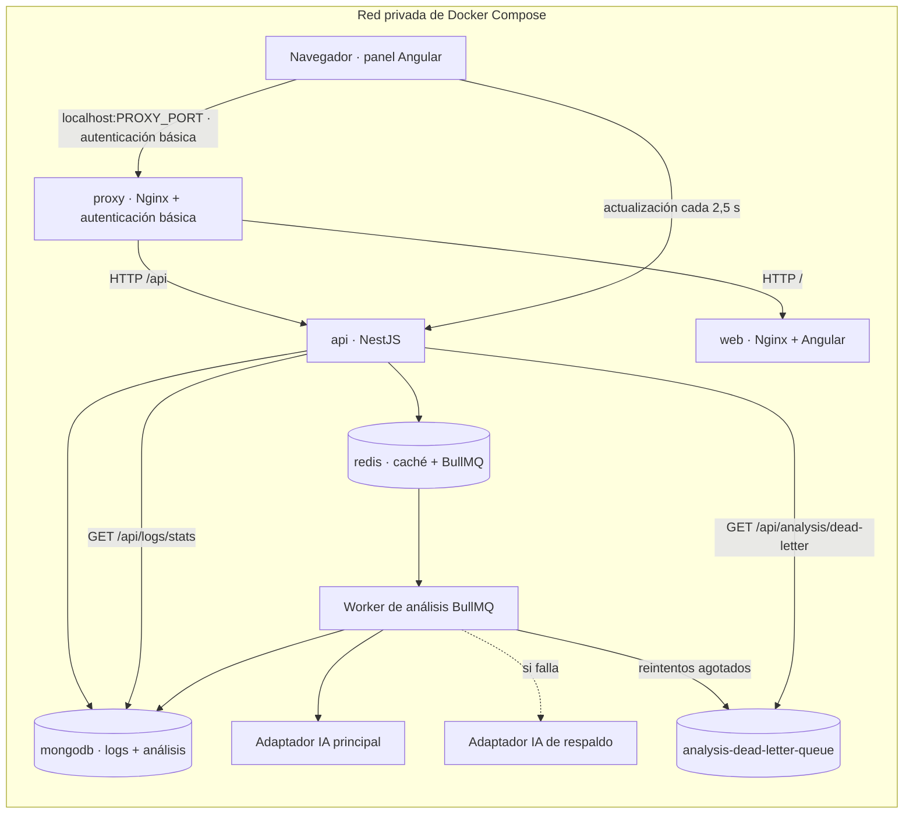

# SmartLog Analyzer — Arquitectura

## Alcance y estado

SmartLog Analyzer es un monorepo pnpm para recibir logs de microservicios, analizarlos con un proveedor externo de IA configurable y seguir los trabajos asíncronos.

Implementado:

- API NestJS con validación de DTO, errores HTTP uniformes, Swagger, persistencia MongoDB mediante TypeORM, caché Nest respaldada por Redis y colas de análisis y fallos con BullMQ.
- Contrato de IA independiente del proveedor y adaptadores nativos para OpenAI Chat Completions, Anthropic Messages y Gemini `generateContent`, con proveedor principal y respaldo, comprobación de salud, reintentos y cola de fallos observable mediante la API.
- Endpoint de agregación MongoDB (`GET /api/logs/stats`) por servicio o nivel y rango de fechas opcional.
- Panel Angular 19 con navegación, tabla paginada y filtrable de logs, formulario de ingesta, lista de análisis con actualización periódica y vista de cola de fallos.
- Scripts de migración, índices y seed, `Makefile`, logs JSON estructurados con correlación de solicitudes, y pruebas unitarias, HTTP de integración y Angular.

Las peticiones externas de IA requieren endpoints y credenciales configuradas en `.env`. Las claves de ejemplo son marcadores. Sin un proveedor principal accesible, el endpoint de disponibilidad informa que la IA no está disponible y los análisis terminan en la cola de fallos al agotarse los reintentos.

## Estructura del monorepo

```text
smartlog-analyzer/
├── src/
│   ├── api/                       # API NestJS
│   │   └── src/
│   │       ├── common/            # Filtros, errores, logs y validadores
│   │       ├── config/            # Resolución de puertos
│   │       ├── db/                # DataSource, migraciones, índices, scripts y seeds
│   │       └── modules/
│   │           ├── logs/          # DTO, persistencia, estadísticas y rutas
│   │           ├── analyses/      # Trabajos, proveedores, colas y rutas
│   │           └── health/        # Salud de API, dependencias y proveedor
│   └── web/                       # Workspace Angular 19 y panel
├── tests/
│   ├── unit/                      # Pruebas de dominio, proveedores, salud y logs
│   ├── integration/               # Contrato HTTP y validaciones
│   └── support/                   # Helpers y adaptadores de Jest
├── Dockerfile                     # Imágenes multi-stage de API, web y proxy
├── nginx-proxy.conf.template      # Entrada HTTP con autenticación básica
├── docker-compose.yml             # Proxy, API, web, MongoDB y Redis
├── Makefile                       # Comandos de desarrollo, pruebas y Compose
├── .env.example                   # Solo valores de ejemplo
├── README.md
└── ARCHITECTURE.md
```

Los workspaces de pnpm se declaran en `pnpm-workspace.yaml`. Los scripts raíz son el punto de entrada para compilar y probar. Las pruebas Angular están junto a sus componentes, bajo `src/web/src/app/**`, porque el builder de Angular resuelve `tsConfig`/`include` desde el proyecto web. Las suites de API están en `tests/`.

## Despliegue y flujo de solicitudes
Ver también Smartlog-Analyzer-Diagram.pdf



El navegador usa un único origen: `http://localhost:${PROXY_PORT}` (8080 por defecto), con autenticación básica para el panel y la API. Nginx envía `/api/` a NestJS y el resto de rutas al contenedor Angular. El proxy elimina el encabezado `Authorization` antes de reenviar. API y web no publican puertos. MongoDB y Redis solo se enlazan a `127.0.0.1` para desarrollo local; dentro de Compose, los servicios usan los nombres DNS `api`, `web`, `mongodb` y `redis`, junto con las URLs de `*_DOCKER`. Los datos de MongoDB y Redis persisten en los volúmenes `mongodb_data` y `redis_data`.

| Servicio | Puerto del contenedor | Puerto del host | Propósito |
|---|---:|---:|---|
| Proxy inverso | 80 | `PROXY_PORT` (8080 por defecto) | Autenticación básica y rutas del panel/API |
| Web / Nginx | 80 | No publicado | Panel Angular |
| API | 3000 | No publicado | REST, salud y Swagger |
| MongoDB | 27017 | `127.0.0.1:MONGO_PORT` | Logs y registros de análisis; acceso local de desarrollo |
| Redis | 6379 | `127.0.0.1:REDIS_PORT` | Caché Nest y colas BullMQ; acceso local de desarrollo |

Compose inicia la API cuando MongoDB y Redis pasan sus comprobaciones de salud. La comprobación del contenedor API llama a `/api/health/live`, que verifica únicamente que el proceso responde. `/api/health` informa `503` si falla una dependencia o el proveedor principal; Compose no usa esta comprobación de disponibilidad para determinar la salud del contenedor, de modo que una caída de un proveedor externo no lo marca como no saludable.

El proxy se inicia después de la API y web. Las credenciales de autenticación básica salen de `.env`; durante el inicio se genera un archivo htpasswd Apache (`apr1`) compatible con Nginx. La autenticación básica sobre HTTP sin TLS no cifra las credenciales; fuera de desarrollo local, el proxy debe estar detrás de TLS.

## API HTTP

Todas las rutas REST usan el prefijo global `/api`. Las respuestas son JSON y los errores comparten esta estructura:

```json
{
  "statusCode": 400,
  "error": "Bad Request",
  "message": "service must be a lowercase slug",
  "path": "/api/logs",
  "timestamp": "2026-11-02T14:00:00.000Z"
}
```

| Método | Ruta | Éxito | Comportamiento |
|---|---|---:|---|
| `POST` | `/api/logs` | 201 | Validar y guardar un log |
| `GET` | `/api/logs` | 200 | Filtrar y paginar logs |
| `GET` | `/api/logs/stats` | 200 | Agrupar logs por servicio o nivel en un rango opcional |
| `POST` | `/api/logs/analyze` | 202 | Validar ObjectIds y encolar un análisis |
| `GET` | `/api/analysis` | 200 | Filtrar y paginar trabajos |
| `GET` | `/api/analysis/dead-letter` | 200 | Consultar la cola de fallos (`limit`, `offset`), solo lectura |
| `GET` | `/api/analysis/{id}` | 200 | Consultar estado, resultado o error terminal |
| `GET` | `/api/health` | 200 / 503 | Disponibilidad de MongoDB, caché Redis, IA, memoria y raíz de API |
| `GET` | `/api/health/live` | 200 | Comprobar que el proceso sigue activo, sin comprobar dependencias |
| `GET` | `/api/docs` | 200 | Swagger UI; documento JSON en `/api/docs-json` |

Las listas aceptan `limit` (20 por defecto, de 1 a 100) y `offset` (0 por defecto, no negativo). Los valores fuera de rango devuelven `400` y no se ajustan silenciosamente. Los logs también admiten `service`, `level`, `from` y `to`; los análisis admiten `status` (`queued`, `processing`, `completed`, `failed`). `from` no puede ser posterior a `to`.

`GET /api/logs/stats?groupBy=service|level&from&to` devuelve `{ groupBy, from, to, total, buckets: [{ key, count }] }`. Los grupos se ordenan por `count` descendente y después por `key` ascendente, con un máximo de 100. El rango incluye el `timestamp` del log.

### Validación y modelo de log

Los controladores reciben DTO decorados con `class-validator`; el `ValidationPipe` global transforma entradas, rechaza propiedades desconocidas y responde `400` ante datos inválidos. El identificador de servicio es un slug en minúsculas que coincide con `^[a-z0-9]+(?:-[a-z0-9]+)*$` y tiene un máximo de 63 caracteres. Las fechas deben ser cadenas ISO. `message` es obligatorio, se recorta y admite hasta 10.000 caracteres.

Los niveles de log usan los valores exportados `LOG_LEVELS` y `LogLevel` de NestJS; SmartLog no define otro enum paralelo. Cada documento también incluye la hora de ingesta y metadatos estructurados opcionales.

Ejemplo de solicitud:

```json
{
  "service": "payment-api",
  "timestamp": "2026-11-02T14:00:00.000Z",
  "level": "error",
  "message": "Payment authorization timed out",
  "metadata": { "requestId": "request-123" }
}
```

Los esquemas Swagger se derivan de los tipos DTO mediante el plugin CLI `@nestjs/swagger`, configurado en `src/api/nest-cli.json`; no se repiten `@ApiProperty` manualmente en cada campo.

## Persistencia: MongoDB y TypeORM

`src/api/src/db/data-source.ts` exporta las opciones de `DataSource` MongoDB de TypeORM que consume `TypeOrmModule.forRoot(AppDataSource)`. Los patrones de entidades se resuelven desde `__dirname`, no desde `process.cwd()`, para funcionar tanto al desarrollar desde `src/api` como en el contenedor, donde el build está en `/app/src/api/dist`. `synchronize` está desactivado. La colección `logs` almacena eventos validados; `analyses` guarda IDs de logs, proveedor, estado del trabajo, prompt opcional, intentos, fechas, resultado y error terminal.

El acceso a datos se separa en `LogsService` y `AnalysesService` mediante repositorios TypeORM Mongo. Los módulos exponen colaboradores entre módulos con interfaces y tokens de inyección: `LogsServiceInterface` se registra bajo el símbolo `LOGS_SERVICE` y los adaptadores bajo `ANALYSIS_PROVIDERS`. La comprobación de salud de Mongo usa el comando nativo `ping` del driver Mongo de TypeORM; no se usa el indicador Terminus orientado a SQL.

### Migraciones, índices y seeds

TypeORM no ofrece migraciones SQL para su driver Mongo. Por ello, las migraciones versionadas de SmartLog usan el driver nativo y se registran en la colección `_smartlog_migrations`. Cada unidad tiene `up` y `down`; el runner aplica migraciones pendientes en orden y solo permite revertir la última aplicada, evitando dejar dependencias de índices fuera de orden. Comandos:

```bash
pnpm --filter smartlog-api run db:migrate -- --dry-run
pnpm --filter smartlog-api run db:migrate
pnpm --filter smartlog-api run db:migrate -- --rollback 002-analysis-indexes
```

Las unidades existentes corresponden a las colecciones y rutas de lectura:

| Migración | Colección | Índices |
|---|---|---|
| `001-log-indexes` | `logs` | `timestamp_-1`, `service_1_timestamp_-1`, `level_1_timestamp_-1` |
| `002-analysis-indexes` | `analyses` | `status_1_createdAt_-1`, `createdAt_-1` |

El campo `prompt` es opcional y MongoDB no requiere transformar documentos antiguos para incorporarlo. No hay migración de datos para ese campo. `src/api/src/db/indexes.ts` mantiene el catálogo compartido; `db:indexes` sigue disponible para crear los índices directamente de forma idempotente, mientras `db:migrate` registra y permite revertir cada unidad.

`src/api/src/db/scripts/seed.ts` inserta un conjunto de demostración reproducible: 40 logs de cuatro servicios y cinco niveles distribuidos en siete días, más dos análisis. `--dry-run` muestra el plan y `--reset` limpia las colecciones `logs` y `analyses` antes de insertar. Sin `--reset`, cada ejecución añade datos.

## Caché Redis y colas

`AppModule` registra el `CacheModule` oficial de Nest con `isGlobal: true` y el adaptador ioredis configurado mediante `REDIS_URL`; los módulos funcionales inyectan el gestor de caché estándar sin wrappers propios. Los controladores usan `CacheInterceptor` para las listas paginadas de logs y el chequeo de salud verifica el gestor de caché. El TTL se configura con `CACHE_TTL_SECONDS`. BullMQ usa la misma URL de Redis para su conexión.

BullMQ usa Redis para:

- `analysis-queue`: análisis pendientes.
- `analysis-dead-letter-queue`: trabajos que agotaron sus reintentos.

`POST /api/logs/analyze` acepta `{ logIds, prompt? }`; el prompt opcional del usuario admite hasta 4.000 caracteres y se guarda con el análisis. La ruta responde inmediatamente con `202 Accepted` y el trabajo en estado `queued`. El worker entrega el prompt y los logs seleccionados al proveedor principal o de respaldo; si no se proporciona, se aplica la solicitud predeterminada de detección de patrones. El worker actualiza el estado a `processing` y luego a `completed` con insights o `failed` con un mensaje de error seguro. La cola usa tres intentos por defecto y espera exponencial desde 1.000 ms; `AI_RETRY_ATTEMPTS` y `AI_RETRY_BACKOFF_MS` configuran la política. Al agotarse los intentos, el worker registra el estado fallido y el error, y agrega a la cola de fallos `analysisId`, `failedReason`, `attempts` y la fecha del trabajo.

La cola de fallos se expone como solo lectura en `GET /api/analysis/dead-letter`; volver a encolar es una operación manual.

## IA independiente del proveedor

`AnalysisProvider` es la interfaz de dominio. Los adaptadores implementan `analyze(logs, prompt?)` y `checkHealth()` para OpenAI Chat Completions, Anthropic Messages y Gemini `generateContent`. El prompt opcional complementa las instrucciones de formato de respuesta, se propaga por la cola y se persiste. Cada adaptador solicita y extrae JSON nativo del proveedor y valida el contrato compartido `{summary, insights}`. Un helper común recorre rutas en respuestas con segmentos numéricos para arreglos (`choices.0.message.content`, `content.0.text`, `candidates.0.content.parts.0.text`).

Los nombres se comparan sin distinguir mayúsculas (`trim().toLowerCase()`), pero se persisten en forma canónica (`OpenAI`, `Anthropic`, `Gemini`); así, `.env` puede usar minúsculas sin alterar registros. Un nombre desconocido no registra un adaptador y produce una advertencia, en vez de seleccionar silenciosamente OpenAI.

La solicitud enviada al proveedor contiene:

```json
{ "logs": [{ "service": "payment-api", "timestamp": "...", "level": "error", "message": "..." }] }
```

El contrato de respuesta validado es:

```json
{
  "summary": "A concise pattern summary",
  "insights": [
    { "title": "Timeout increase", "description": "Payment timeouts cluster after deploy.", "severity": "high" }
  ]
}
```

Se intenta primero con el proveedor principal y luego con el de respaldo si falla. El registro de proveedores registra cada fallo; si ambos fallan, devuelve un error a BullMQ, que aplica reintentos exponenciales. Al agotarse, el trabajo se marca como fallido y se mueve a la cola de fallos. El endpoint de salud consulta solo el proveedor principal; la disponibilidad del respaldo no oculta un fallo del principal.

OpenAI usa `AI_PROVIDER_OPENAI_URL`, `AI_PROVIDER_OPENAI_HEALTH_URL`, `AI_PROVIDER_OPENAI_API_KEY` y `AI_PROVIDER_OPENAI_MODEL`. Anthropic usa las variables equivalentes `AI_PROVIDER_ANTHROPIC_*`. Gemini usa `AI_PROVIDER_GEMINI_URL`, `AI_PROVIDER_GEMINI_HEALTH_URL` y `AI_PROVIDER_GEMINI_API_KEY`.

## Logs estructurados

`JsonLoggerService` implementa `LoggerService` de Nest y escribe una línea JSON por evento en stdout: `{ timestamp, level, context?, message, ...meta }`. Los errores serializan `error` y `stack`; los objetos estructurados se combinan sin sobrescribir las claves reservadas (`timestamp`, `level`, `context`, `message`).

`RequestLoggingMiddleware` asigna un ID a cada solicitud —reutiliza `x-request-id` entrante o genera un UUID—, lo devuelve en la respuesta y registra `{ requestId, method, path, status, durationMs }` al terminar. `main.ts` configura ambos con `bufferLogs`, de modo que los logs de inicio también usan el logger JSON.

## Salud y documentación de la API

`GET /api/health` es el informe de disponibilidad. Comprueba la respuesta raíz de la API, los límites de memoria heap/RSS y dependencias MongoDB, gestor de caché Nest respaldado por Redis y proveedor activo de IA. La comprobación raíz consulta el prefijo `/api`, no la URL base sin prefijo. Los chequeos personalizados usan los resultados de `HealthIndicatorService` de Terminus en vez del obsoleto `HealthCheckError`; `GlobalHttpExceptionFilter` conserva el detalle de cada chequeo cuando la disponibilidad responde `503`.

`GET /api/health/live` es el chequeo de actividad. Devuelve `{ status, uptime }` sin consultar MongoDB, Redis, HTTP ni al proveedor de IA; Compose usa esta ruta para la comprobación del contenedor. Con claves de IA de ejemplo, disponibilidad devuelve `503`, pero el contenedor sigue activo.

## Interfaz web

La aplicación Angular cuenta con rutas `/logs` y `/analyses`; `''` y `**` redirigen a `/logs`. El tema claro se implementa con propiedades CSS en `src/web/src/styles.scss` (`--surface`, `--text`, `--accent`, `--danger`, `--radius`, `--space-*`). Cada funcionalidad conserva sus estilos para evitar agotar el presupuesto de la hoja global.

- **Logs**: filtros por `service`, `level`, `from` y `to`; formulario de ingesta; tabla seleccionable; prompt opcional para la acción de análisis; paginación de 10/20/50 elementos con anterior/siguiente y rango. Si la página recibida está vacía y `offset > 0`, calcula la última página válida y vuelve a consultarla si cambia.
- **Análisis**: filtro por estado, lista paginada, indicadores por estado, resultado con proveedor/resumen/insights, error terminal, cola de fallos y actualización cada 2,5 segundos mientras haya trabajos `queued` o `processing`. Actualiza cada trabajo pendiente mediante `GET /api/analysis/{id}` y detiene la consulta cuando no quedan pendientes o se destruye el componente.

`LogsApiService` centraliza las llamadas HTTP, omite filtros vacíos y asigna la fecha actual a la ingesta cuando no se especifica. Los errores muestran el campo compartido `{ message }` y no un mensaje de transporte genérico.

## Pruebas

`pnpm test` ejecuta pruebas unitarias, HTTP de integración y Angular/Karma. Comandos específicos: `pnpm test:unit`, `pnpm test:integration` y `pnpm test:web`.

- **Unitarias**: registro de proveedores, tres adaptadores (respuesta válida, formato incorrecto y timeout), fallo terminal del worker, logger JSON, middleware de solicitudes, resolución de puertos y salud.
- **Integración**: pipeline HTTP Nest con repositorios, caché, cola y proveedores sustituidos; valida paginación, filtros, estadísticas, cola de fallos, rutas de análisis y formato de errores. No requiere MongoDB, Redis ni proveedores reales.
- **Web**: pruebas Karma/ChromeHeadless del cliente API, paginación, página de logs, página de análisis (polling con `fakeAsync`) y shell con rutas.

Si el proceso ejecuta Karma como root, Chrome usa `--no-sandbox` mediante `src/web/karma.conf.cjs`; configura `CHROME_BIN` si Chrome no está en `PATH`.

## Docker y entorno

El Dockerfile multi-stage construye con Node Alpine y usa Nginx Alpine para servir el panel. MongoDB usa la imagen oficial basada en Ubuntu, porque no existe una variante Alpine oficial. Redis usa `redis:7-alpine`. La imagen final de API contiene solo las dependencias de producción del workspace y el bundle compilado de Nest.

| Variable | Propósito |
|---|---|
| `PROXY_PORT` | Puerto HTTP de entrada publicado en el host |
| `MONGO_PORT`, `REDIS_PORT` | Puertos locales, limitados a loopback |
| `HTTP_AUTH_USERNAME`, `HTTP_AUTH_PASSWORD` | Credenciales Nginx Basic Auth |
| `NODE_ENV`, `API_PORT` | Entorno API y puerto interno (`PORT` tiene prioridad si está definido) |
| `MONGODB_IMAGE`, `REDIS_IMAGE` | Versiones de imágenes de infraestructura |
| `MONGODB_INITDB_ROOT_USERNAME`, `MONGODB_INITDB_ROOT_PASSWORD`, `MONGODB_DATABASE` | Inicialización de MongoDB |
| `MONGODB_URI`, `REDIS_URL`, `APP_BASE_URL` | Direcciones para procesos ejecutados en el host |
| `MONGODB_URI_DOCKER`, `REDIS_URL_DOCKER`, `APP_BASE_URL_DOCKER` | Direcciones dentro de Compose |
| `REDIS_PASSWORD` | Autenticación Redis |
| `CACHE_TTL_SECONDS` | Expiración de caché Redis |
| `AI_PROVIDER`, `AI_FALLBACK_PROVIDER` | Adaptadores principal y de respaldo |
| `AI_PROVIDER_<NAME>_URL` | Endpoint de análisis |
| `AI_PROVIDER_<NAME>_HEALTH_URL` | Endpoint de salud del proveedor |
| `AI_PROVIDER_<NAME>_API_KEY` | Credencial del proveedor |
| `AI_PROVIDER_OPENAI_MODEL`, `AI_PROVIDER_ANTHROPIC_MODEL` | Modelos de OpenAI y Anthropic |
| `AI_REQUEST_TIMEOUT_MS`, `AI_HEALTH_TIMEOUT_MS` | Timeouts de las peticiones |
| `AI_RETRY_ATTEMPTS`, `AI_RETRY_BACKOFF_MS` | Política de reintentos/backoff de BullMQ |
| `HEALTH_CHECK_MEMORY_HEAP_LIMIT`, `HEALTH_CHECK_MEMORY_RSS_LIMIT` | Límites de salud en MiB |

Copia `.env.example` a `.env`, reemplaza URLs y credenciales de ejemplo y no incluyas `.env` en control de versiones. `docker compose down` conserva los volúmenes; `docker compose down -v` elimina también los datos de base y caché/cola.

## Registro de decisiones

| # | Decisión | Alternativa descartada | Motivo |
|---|---|---|---|
| 1 | Los análisis se consultan en `GET /api/analysis`, `GET /api/analysis/:id` y `GET /api/analysis/dead-letter`; el encolado permanece en `POST /api/logs/analyze`. | Mantener `/api/logs/analysis` y cambiar el panel, las pruebas y la documentación. | La documentación, el cliente Angular y las pruebas ya asumían `/api/analysis`; anidar una colección de primer nivel bajo `/logs` mezcla jerarquías. |
| 2 | El módulo separa `AnalysesController` (`@Controller('analysis')`) y `LogAnalysisController` (`@Controller('logs')`, solo encolado); `dead-letter` se declara antes de `:id`. | Un único controlador con rutas absolutas. | Mantiene el encolado junto al módulo dueño de la cola y evita importaciones circulares entre `LogsModule` y `AnalysesModule`. |
| 3 | Los nombres de proveedores se comparan con `trim().toLowerCase()` y se persisten canónicamente. | Pasar los valores del enum a minúsculas. | `analyses.provider` conserva valores estables (`OpenAI`, etc.) y `.env` puede seguir usando minúsculas. |
| 4 | La cola de fallos se consulta en modo solo lectura mediante `GET /api/analysis/dead-letter?limit&offset`. | Consumir la cola y duplicar las entradas en MongoDB. | BullMQ ya es la fuente de verdad; duplicarla agrega esquema y riesgo de divergencia. |
| 5 | La agregación usa un pipeline Mongo `$match`/`$group`/`$sort` en `GET /api/logs/stats?groupBy=service|level&from&to`. | Cargar todos los logs y agrupar en Node. | La base devuelve el resultado en una consulta sin transferir toda la colección. |
| 6 | Las migraciones Mongo son unidades versionadas por colección, con `up` y `down`; las registra `_smartlog_migrations` y se revierten en orden inverso. | Usar migraciones SQL de TypeORM o un script no versionado como única herramienta. | El driver Mongo no ofrece migraciones SQL; los índices son el requisito actual y conviene mantener su historial y reversión. |
| 7 | `pnpm seed` inserta 40 logs de cuatro servicios y cinco niveles, más dos análisis; `--reset` y `--dry-run` permiten controlar la ejecución. | Fixtures JSON solo para pruebas. | El conjunto debe permitir probar manualmente paginación, filtros, agregación y panel. |
| 8 | La configuración Jest usa `rootDir` en `src/api`, las suites bajo `tests/` y el mapeo `^src/(.*)$` a `<rootDir>/src/$1`. | Instalar `ts-jest` en la raíz del monorepo. | Reutiliza dependencias de la aplicación, evita cambios de lockfile y sigue el mapeo de TypeScript existente. |
| 9 | Las pruebas de modelos de IA simulan el cliente HTTP inyectado y validan payload correcto, incorrecto y timeout por adaptador. | Interceptar red con `nock` o levantar un servidor falso. | `HttpService` llega por DI; el mock no agrega dependencias y simula timeouts de forma determinista. |
| 10 | Los logs estructurados usan un logger JSON sin dependencias y middleware de correlación (`x-request-id`, método, ruta, estado y duración). | Añadir `nestjs-pino`/`pino`. | Una clase cubre el prototipo sin incluir transports ni configuración adicional. |
| 11 | El shell tiene dos rutas (`/logs`, `/analyses`) y un componente reutilizable de paginación (10/20/50, anterior/siguiente, rango y total). | Concentrar todo en `AppComponent`. | Separar ingesta, listados y seguimiento de análisis mejora la prueba por unidad y reduce estilos compartidos. |
| 12 | Las pruebas Angular viven junto a `src/web/src/app/**`; `src/web/karma.conf.cjs` fija la resolución del plugin y el launcher `ChromeHeadlessNoSandbox`. | Configurar el target Karma en `tests/web` con rutas relativas a la raíz. | El builder resuelve `tsConfig`/`include` desde el proyecto web; las rutas desde la raíz rompen el target. |
| 13 | `Makefile` expone comandos de instalación, desarrollo, compilación, pruebas, seed, índices, migraciones y Compose. | Usar solo scripts pnpm. | El Makefile hace visibles los flujos habituales y compone comandos del workspace. |
| 14 | Swagger deriva los esquemas del plugin CLI `@nestjs/swagger` en `nest-cli.json`. | Añadir `@ApiProperty` manualmente a cada campo DTO. | El plugin usa tipos TS y validadores sin mezclar documentación con validación. |
| 15 | La API escucha en `PORT`, después `API_PORT`, y por último 3000. | Usar solo `PORT` y documentarlo. | `.env` local define `API_PORT`; antes la ejecución `pnpm start:api` lo ignoraba. |
| 16 | El frontend usa tokens CSS de tema claro, separados entre shell y componentes funcionales. | Mantener la hoja oscura previa de 12 kB. | La hoja existente estaba en el límite de tamaño y no podía incorporar paginación y filtros. |

## Trabajo pendiente

- Añadir adaptadores para otros proveedores y pruebas de contrato reales contra proveedores externos.
- Invalidar la caché tras ingerir logs y definir la frescura requerida para los listados.
- Añadir una acción de reencolado de DLQ cuando exista una política operativa.
- Incorporar retención, redacción, autenticación/autorización, límites de tasa y gestión de secretos de producción.
- Añadir trazas y métricas; actualmente la superficie de observabilidad son los logs estructurados y los chequeos de disponibilidad.
