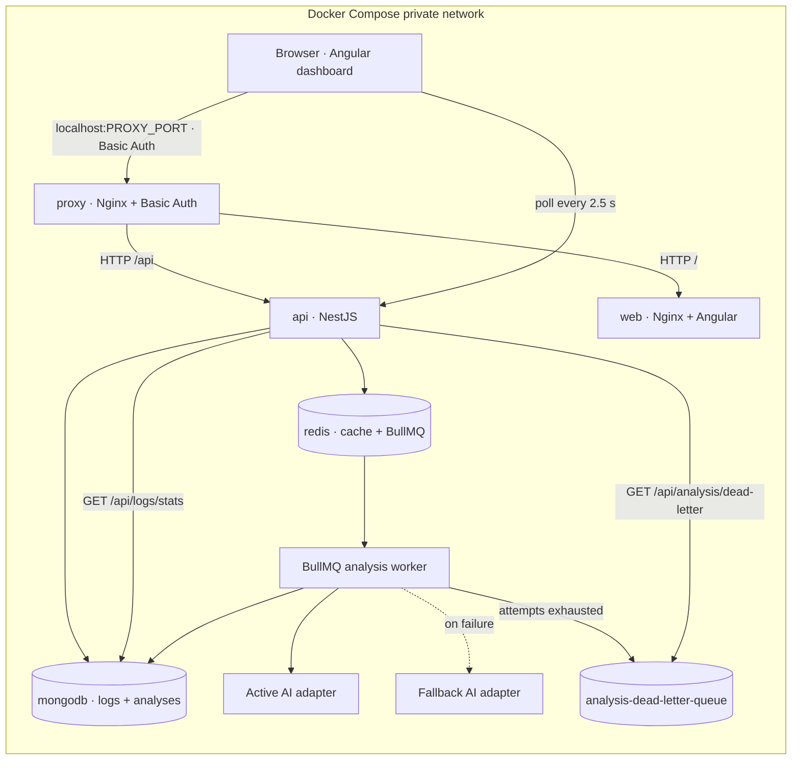

# SmartLog Analyzer — Architecture

## Scope and implementation status

SmartLog Analyzer is a pnpm monorepo for collecting microservice logs, reviewing them with a configurable external AI provider, and tracking asynchronous analysis jobs.

Implemented:

- NestJS API with DTO validation, consistent HTTP errors, Swagger, MongoDB persistence through TypeORM, Redis-backed Nest cache, and BullMQ analysis and dead-letter queues.
- Provider-agnostic AI contract with native OpenAI Chat Completions, Anthropic Messages and Gemini `generateContent` adapters, active/fallback selection, health probe, retry/backoff and a dead-letter queue observable through the API.
- Mongo aggregation endpoint (`GET /api/logs/stats`) grouped by service or level over an optional date range.
- Angular 19 dashboard with a routed shell, paginated log table with filters and ingestion, analysis list with live polling, and a dead-letter view.
- Seed and index-creation scripts, a `Makefile`, structured JSON logging with request correlation, and unit, HTTP integration and Angular tests.

External AI requests require provider endpoints and credentials in `.env`. The sample keys are placeholders. Without a reachable active provider, the readiness endpoint reports the provider as down and analysis jobs eventually enter the dead-letter queue after retry exhaustion.

## Monorepo layout

```text
smartlog-analyzer/
├── src/
│   ├── api/                       # NestJS API
│   │   └── src/
│   │       ├── common/            # Filters, errors, logging, validators
│   │       ├── config/            # Port resolution
│   │       ├── db/                # DataSource, index definitions, scripts, seeds
│   │       └── modules/
│   │           ├── logs/          # Log DTOs, persistence, stats, endpoints
│   │           ├── analyses/      # Analysis jobs, providers, queues, endpoints
│   │           └── health/        # API/dependency/provider health
│   └── web/                       # Angular 19 workspace and dashboard
├── tests/
│   ├── unit/                      # Unit tests for domain/provider/health/logging behavior
│   ├── integration/               # HTTP contract and validation tests
│   └── support/                   # Jest helpers and shims
├── Dockerfile                     # Multi-stage API, web and proxy images
├── nginx-proxy.conf.template      # Basic-authenticated HTTP ingress
├── docker-compose.yml             # Proxy, API, web, MongoDB and Redis
├── Makefile                       # install/dev/build/test/seed/indexes/up/down/logs
├── .env.example                   # Placeholder environment values only
├── README.md
└── ARCHITECTURE.md
```

pnpm workspaces are declared in `pnpm-workspace.yaml`. Root scripts are the supported entry point for builds and tests. Angular specs are co-located with their components under `src/web/src/app/**` because the Angular karma builder resolves `tsConfig`/`include` relative to the web project; the API suites live under the root `tests/` directory.

## Deployment and request flow



The browser uses one origin: `http://localhost:${PROXY_PORT}` (8080 by default), with Basic Authentication on dashboard and API routes. Nginx routes `/api/` to NestJS and all other paths to the Angular web container. It removes the inbound `Authorization` header before proxying. API and web ports are not published. MongoDB and Redis bind only to `127.0.0.1` for local development; within Compose, services use DNS names (`api`, `web`, `mongodb`, `redis`) and the container-specific connection URLs from `*_DOCKER` variables. MongoDB data persists in `mongodb_data`; Redis cache and queue data persist in `redis_data`.

| Service | Container port | Host port | Purpose |
|---|---:|---:|---|
| Reverse proxy | 80 | `PROXY_PORT` (8080 default) | Basic Auth ingress; routes dashboard and API |
| Web / Nginx | 80 | Not published | Angular dashboard |
| API | 3000 | Not published | REST endpoints, health and Swagger |
| MongoDB | 27017 | `127.0.0.1:MONGO_PORT` | Logs and analysis records; local development access |
| Redis | 6379 | `127.0.0.1:REDIS_PORT` | Nest cache and BullMQ queues; local development access |

Compose starts the API after MongoDB and Redis pass their health checks. The API container healthcheck calls `/api/health/live`, which only verifies that the process answers. Readiness lives at `/api/health`, where dependency or active-provider failures report 503; Compose deliberately does not gate container health on it, so a third-party AI outage cannot mark the container unhealthy.

The proxy starts after the API and web containers have started. Basic Auth credentials are read from `.env`; an Apache MD5 (`apr1`) htpasswd file is generated at container startup for Nginx compatibility. Basic Auth over plain HTTP does not encrypt credentials, so deploy behind TLS outside local development.

## HTTP API

All REST routes use the `/api` global prefix. Responses are JSON. Errors have a common shape:

```json
{
  "statusCode": 400,
  "error": "Bad Request",
  "message": "service must be a lowercase slug",
  "path": "/api/logs",
  "timestamp": "2026-11-02T14:00:00.000Z"
}
```

| Method | Route | Success | Behavior |
|---|---|---:|---|
| `POST` | `/api/logs` | 201 | Validate and persist a log |
| `GET` | `/api/logs` | 200 | Filter and paginate logs |
| `GET` | `/api/logs/stats` | 200 | Aggregate logs by service or level over an optional range |
| `POST` | `/api/logs/analyze` | 202 | Validate log ObjectIds and queue an analysis |
| `GET` | `/api/analysis` | 200 | Filter and paginate analysis jobs |
| `GET` | `/api/analysis/dead-letter` | 200 | Read-only dead-letter listing (`limit`, `offset`) |
| `GET` | `/api/analysis/{id}` | 200 | Get current status, result or terminal error |
| `GET` | `/api/health` | 200 / 503 | Readiness: MongoDB, Redis cache, active AI provider, memory and API root |
| `GET` | `/api/health/live` | 200 | Liveness: process is running; no dependency checks |
| `GET` | `/api/docs` | 200 | Swagger UI; JSON document at `/api/docs-json` |

List endpoints accept `limit` (default 20, between 1 and 100) and `offset` (default 0, non-negative). Out-of-range values return `400` instead of being silently clamped. Logs additionally accept `service`, `level`, `from` and `to`; analyses accept `status` (`queued`, `processing`, `completed`, `failed`). `from` must not be later than `to`.

`GET /api/logs/stats?groupBy=service|level&from&to` returns `{ groupBy, from, to, total, buckets: [{ key, count }] }`. Buckets are sorted by `count` descending then `key` ascending, capped at 100, and the range is inclusive on the log event `timestamp`.

### Input validation and log model

Controllers accept DTOs decorated with `class-validator`; the global Nest `ValidationPipe` transforms inputs, rejects unknown fields, and returns HTTP 400 for invalid input. A service identifier is a lowercase slug matching `^[a-z0-9]+(?:-[a-z0-9]+)*$` and is limited to 63 characters. Timestamps must be ISO date strings. Messages are trimmed, required, and limited to 10,000 characters.

Log levels use NestJS's exported `LOG_LEVELS` and `LogLevel` values; SmartLog does not define a parallel level enum. A log document also includes an ingestion timestamp and optional structured metadata.

Example request:

```json
{
  "service": "payment-api",
  "timestamp": "2026-11-02T14:00:00.000Z",
  "level": "error",
  "message": "Payment authorization timed out",
  "metadata": { "requestId": "request-123" }
}
```

Swagger schemas are derived from the DTO types by the `@nestjs/swagger` CLI plugin configured in `src/api/nest-cli.json`; DTOs stay focused on validation and no field hand-writes `@ApiProperty`.

## Persistence: MongoDB and TypeORM

`src/api/src/db/data-source.ts` exports the TypeORM MongoDB `DataSourceOptions` consumed by `TypeOrmModule.forRoot(AppDataSource)`. Entity and migration globs resolve from `__dirname`, not `process.cwd()`, so discovery works both from `src/api` in development and from `/app` in the container where the build output lives under `/app/src/api/dist`. `synchronize` is disabled. The `logs` collection stores validated log events; `analyses` stores requested log IDs, provider, job status, attempts, timestamps, result and terminal error.

Data access is separated into `LogsService` and `AnalysesService` using TypeORM Mongo repositories. Modules expose cross-module collaborators through interfaces and string-free DI tokens: `LogsServiceInterface` is registered under the `LOGS_SERVICE` symbol, and AI adapters under `ANALYSIS_PROVIDERS`, so consumers depend on contracts rather than concrete classes. Mongo health uses the TypeORM Mongo driver's native `ping` command; the SQL-oriented Terminus TypeORM indicator is not used for a Mongo connection.

### Indexes and seed data

TypeORM's Mongo driver has no SQL-style migrations, so the schema concern that matters for read paths — indexes — is a first-class script. `src/api/src/db/indexes.ts` defines five indexes; `src/api/src/db/scripts/create-indexes.ts` applies them idempotently (`pnpm --filter smartlog-api run db:indexes`, `--dry-run` to preview):

| Collection | Index |
|---|---|
| `logs` | `timestamp_-1` |
| `logs` | `service_1_timestamp_-1` |
| `logs` | `level_1_timestamp_-1` |
| `analyses` | `status_1_createdAt_-1` |
| `analyses` | `createdAt_-1` |

`src/api/src/db/scripts/seed.ts` inserts a deterministic demo dataset (40 logs across four services and five levels over seven days, plus two analyses) and supports `--dry-run` and `--reset` (`pnpm --filter smartlog-api run seed`).

## Redis cache and queues

`AppModule` registers Nest's official `CacheModule` with `isGlobal: true` and the ioredis store adapter configured from `REDIS_URL`; feature modules inject the standard cache manager without custom wrappers. Controllers use Nest's `CacheInterceptor` for the paginated log list, and the health check verifies the cache through the cache manager API. Cache TTL is configured by `CACHE_TTL_SECONDS`. BullMQ configures its own Redis connection from the same URL.

BullMQ uses Redis for:

- `analysis-queue`: queued analysis work.
- `analysis-dead-letter-queue`: jobs whose attempts are exhausted.

`POST /api/logs/analyze` responds immediately with `202 Accepted` and a task in `queued` state. The worker changes the persisted status to `processing`, then to `completed` with insights or `failed` with a safe error message. The queue defaults to three attempts with exponential backoff starting at 1,000 ms; `AI_RETRY_ATTEMPTS` and `AI_RETRY_BACKOFF_MS` configure the policy. On terminal failure the worker writes the failed status, logs the failure, and adds a durable entry to `analysis-dead-letter-queue` carrying `analysisId`, `failedReason`, `attempts` and the job timestamp.

Dead letters are exposed read-only through `GET /api/analysis/dead-letter`; requeueing is intentionally a manual operation (re-post the analysis or remove the job).

## Provider-agnostic AI

`AnalysisProvider` is the domain interface. Native adapters implement `analyze(logs)` and `checkHealth()` for OpenAI Chat Completions, Anthropic Messages and Gemini `generateContent`. Each requests and reads provider-native JSON content and validates the shared `{summary, insights}` result contract. Responses are traversed by a shared path helper that indexes arrays with numeric path segments (`choices.0.message.content`, `content.0.text`, `candidates.0.content.parts.0.text`).

Provider names are compared case-insensitively (`trim().toLowerCase()`) but persisted with their canonical spelling (`OpenAI`, `Anthropic`, `Gemini`), so `.env` can stay lowercase while stored records keep a stable value. Unknown configured names register nothing and log a warning instead of silently falling back to OpenAI.

The request sent to a provider is:

```json
{ "logs": [{ "service": "payment-api", "timestamp": "...", "level": "error", "message": "..." }] }
```

The validated response contract is:

```json
{
  "summary": "A concise pattern summary",
  "insights": [
    { "title": "Timeout increase", "description": "Payment timeouts cluster after deploy.", "severity": "high" }
  ]
}
```

Execution order is active provider, then fallback provider on active failure. The registry logs each failed provider; if the fallback also fails, it returns an error to BullMQ, which applies exponential retries. Once attempts are exhausted the job is marked failed and moved to the DLQ. The health endpoint probes the active provider only; fallback availability does not mask an unhealthy active provider.

OpenAI uses `AI_PROVIDER_OPENAI_URL`, `AI_PROVIDER_OPENAI_HEALTH_URL` and `AI_PROVIDER_OPENAI_API_KEY`, plus `AI_PROVIDER_OPENAI_MODEL`; Anthropic uses the corresponding `AI_PROVIDER_ANTHROPIC_*` variables; Gemini uses `AI_PROVIDER_GEMINI_*`. Select a provider by setting `AI_PROVIDER` or `AI_FALLBACK_PROVIDER` to one of those names. Provider credentials stay on the API side, are never sent to Angular, and must be replaced with deployment secrets outside local development. Logs may contain secrets or personal data: redact sensitive fields before sending them to any external provider. Provider outputs are suggestions, not verified facts.

## Structured logging

`JsonLoggerService` implements Nest's `LoggerService` and writes one JSON line per entry to stdout: `{ timestamp, level, context?, message, ...meta }`. Errors serialize `error` and `stack`; structured objects merge into the line without overwriting the reserved keys (`timestamp`, `level`, `context`, `message`).

`RequestLoggingMiddleware` assigns every request an id — reusing an inbound `x-request-id` or generating a UUID — echoes it as a response header, and logs `{ requestId, method, path, status, durationMs }` once on `finish`. `main.ts` wires both with `bufferLogs`, so bootstrap logs also pass through the JSON logger.

## Health and API documentation

`GET /api/health` is the readiness report. It keeps checks for the API root response and memory heap/RSS limits and integrates project-native checks for MongoDB, the Nest cache manager backed by Redis, and the active AI provider. The root check probes the `/api` prefix root, not the bare base URL, because the API is mounted under a global prefix. Custom check failures use Terminus's `HealthIndicatorService` results rather than the deprecated `HealthCheckError`; `GlobalHttpExceptionFilter` preserves the per-check detail when readiness answers 503.

`GET /api/health/live` is the liveness probe. It returns `{ status, uptime }` without touching MongoDB, Redis, HTTP or the AI provider, which is what the Compose healthcheck consumes. With placeholder AI credentials readiness reports 503 while the container still reports healthy.

## Frontend

The Angular app is a routed shell (`/logs`, `/analyses`, redirects from `''` and `**` to `/logs`) with a light theme expressed through CSS custom properties in `src/web/src/styles.scss` (`--surface`, `--text`, `--accent`, `--danger`, `--radius`, `--space-*`). Each feature owns its stylesheet instead of sharing one budget-limited global sheet.

- **Logs page** — filter form (`service`, `level`, `from`, `to`), ingestion form, selectable table, analyze-selected action, pagination (10/20/50 per page, previous/next, range text). When an empty page arrives with `offset > 0`, it recomputes the last valid offset and refetches only if it differs.
- **Analyses page** — status filter, paginated list, per-status badges, provider/summary/insights rendering, terminal error line, dead-letter section, and polling every 2.5 s while any job is `queued` or `processing`. Polling refreshes each pending job through `GET /api/analysis/{id}` and stops when none remain or when the component is destroyed.

`LogsApiService` is the single HTTP client; it omits blank filters and defaults the ingestion timestamp to now. API errors are rendered from the shared `{ message }` envelope rather than a generic transport string.

## Tests

`pnpm test` runs unit, HTTP integration and Angular/Karma suites; targeted commands are `pnpm test:unit`, `pnpm test:integration` and `pnpm test:web`.

- **Unit** — provider registry, all three adapters (valid payload, malformed payload, timeout), queue processor terminal failure, JSON logger and request middleware, port resolution and health behavior.
- **Integration** — Nest HTTP pipeline with repository, cache, queue and provider collaborators stubbed: pagination bounds, filters, log stats, dead-letter listing, analysis routes and the consistent error envelope. No live MongoDB, Redis or provider is required.
- **Web** — Karma/ChromeHeadless specs for the API client, pagination, logs page, analyses page (fakeAsync polling) and routed shell.

Karma runs headless Chrome with `--no-sandbox` when the process is root (`src/web/karma.conf.cjs`); set `CHROME_BIN` if Chrome is not on `PATH`.

## Docker and environment

The multi-stage Dockerfile builds on Node Alpine; the runtime web image is Nginx Alpine. MongoDB uses its official Ubuntu-based image because the official Mongo image does not provide an Alpine variant. Redis uses `redis:7-alpine`. The production API image contains only filtered production workspace dependencies and the compiled Nest bundle.

| Variable | Purpose |
|---|---|
| `PROXY_PORT` | Host-published HTTP ingress |
| `MONGO_PORT`, `REDIS_PORT` | Loopback-only ports for local development |
| `HTTP_AUTH_USERNAME`, `HTTP_AUTH_PASSWORD` | Nginx Basic Auth credentials |
| `NODE_ENV`, `API_PORT` | API runtime and internal upstream port (`PORT` takes precedence when set) |
| `MONGODB_IMAGE`, `REDIS_IMAGE` | Infrastructure image tags |
| `MONGODB_INITDB_ROOT_USERNAME`, `MONGODB_INITDB_ROOT_PASSWORD`, `MONGODB_DATABASE` | MongoDB initialization |
| `MONGODB_URI`, `REDIS_URL`, `APP_BASE_URL` | Host-local API connection endpoints |
| `MONGODB_URI_DOCKER`, `REDIS_URL_DOCKER`, `APP_BASE_URL_DOCKER` | API connection endpoints inside Compose |
| `REDIS_PASSWORD` | Redis authentication |
| `CACHE_TTL_SECONDS` | Redis cache expiration |
| `AI_PROVIDER`, `AI_FALLBACK_PROVIDER` | Active and fallback adapter names |
| `AI_PROVIDER_<NAME>_URL` | Provider analysis endpoint |
| `AI_PROVIDER_<NAME>_HEALTH_URL` | Provider health endpoint |
| `AI_PROVIDER_<NAME>_API_KEY` | Provider credential |
| `AI_PROVIDER_OPENAI_MODEL`, `AI_PROVIDER_ANTHROPIC_MODEL` | Model identifiers for OpenAI and Anthropic |
| `AI_REQUEST_TIMEOUT_MS`, `AI_HEALTH_TIMEOUT_MS` | Provider request timeouts |
| `AI_RETRY_ATTEMPTS`, `AI_RETRY_BACKOFF_MS` | BullMQ retry/backoff policy |
| `HEALTH_CHECK_MEMORY_HEAP_LIMIT`, `HEALTH_CHECK_MEMORY_RSS_LIMIT` | Health limits in MiB |

Copy `.env.example` to `.env`, replace all placeholder URLs and credentials, and keep `.env` out of version control. `docker compose down` preserves named volumes; `docker compose down -v` deletes database and queue/cache data.

## Decision log

| # | Decision | Alternative discarded | Why |
|---|---|---|---|
| 1 | Analyses are served at `GET /api/analysis`, `GET /api/analysis/:id` and `GET /api/analysis/dead-letter`; enqueue stays at `POST /api/logs/analyze`. | Keep `/api/logs/analysis` and change the frontend, tests and docs. | Docs, the Angular client and the integration specs already assumed `/api/analysis`; nesting a top-level collection under `/logs` is the wrong hierarchy. |
| 2 | Split the analyses module into `AnalysesController` (`@Controller('analysis')`) and `LogAnalysisController` (`@Controller('logs')`, enqueue only); `dead-letter` is declared before `:id`. | One controller with absolute paths. | Keeps enqueue in the module that owns the queue while avoiding a circular import between `LogsModule` and `AnalysesModule`. |
| 3 | Normalize provider names with `trim().toLowerCase()` on both sides of the registry comparison; persist canonical display names. | Lowercase the enum values. | The registry value is persisted in `analyses.provider`; keeping `OpenAI` stable preserves existing records while `.env` stays lowercase. |
| 4 | Dead letters are read-only through `GET /api/analysis/dead-letter?limit&offset`, returning job id, analysis id, failed reason, attempts and timestamp. | A worker that consumes the DLQ and persists rows to Mongo. | The queue already holds the truth; duplicating it adds a schema and a second source of divergence. A read endpoint proves the queue is used. |
| 5 | Aggregation at `GET /api/logs/stats?groupBy=service|level&from&to` with a Mongo `$match`/`$group`/`$sort` pipeline. | Fetch logs and aggregate in Node. | The checklist asks for an aggregation query; DB-side avoids loading the collection and answers in one round trip. |
| 6 | "Migration" means an idempotent index-creation script (`pnpm db:indexes`). | TypeORM migrations. | TypeORM's Mongo driver has no SQL-style migrations; indexes are the schema concern that actually matters for Mongo read paths. |
| 7 | `pnpm seed` inserts a demo dataset (40 logs, four services, five levels, seven days, plus two analyses) and supports `--reset`/`--dry-run`. | JSON fixtures consumed only by tests. | A runnable dataset is required to exercise pagination, filters, aggregation and the dashboard manually. |
| 8 | Jest configs set `rootDir` to `src/api`, `roots` to the repo `tests/` subfolders, and map `^src/(.*)$` to `<rootDir>/src/$1`. | Install `ts-jest` at the repository root. | Follows the app's own `node_modules`, avoids lockfile churn, and mirrors the TypeScript path mapping the code already uses. |
| 9 | LLM tests mock the injected HTTP client and cover valid payload, malformed payload and timeout for each adapter. | Network interception (`nock`) or a fake provider server. | Providers receive `HttpService` through DI; a mock needs no new dependency and simulates a timeout deterministically. |
| 10 | Structured logging is a dependency-free JSON logger plus request middleware (`x-request-id`, method, path, status, duration). | `nestjs-pino`/`pino`. | One small class covers the requirement; a logging framework adds transports and configuration this prototype does not need. |
| 11 | The shell has two routes (`/logs`, `/analyses`) with redirects, plus a reusable pagination component (10/20/50, previous/next, range and total). | A single `AppComponent` doing everything. | The old component sat at the style budget and mixed ingestion, listing and polling; splitting keeps units testable and styles small. |
| 12 | Angular specs are co-located under `src/web/src/app/**`, with `src/web/karma.conf.cjs` anchoring plugin resolution and a `ChromeHeadlessNoSandbox` launcher. | Point the karma target at `tests/web` with an `include` glob. | The Angular builder resolves `tsConfig`/`include` relative to the web project, so root-relative spec paths break the test target. |
| 13 | A `Makefile` exposes install, dev, build, test, seed, indexes and Compose targets. | pnpm scripts only. | The checklist asks for a Makefile or automation scripts; a Makefile is discoverable and composes the workspace commands. |
| 14 | Swagger schemas come from the `@nestjs/swagger` CLI plugin in `nest-cli.json`. | Hand-written `@ApiProperty` on every DTO field. | The plugin derives schemas from TypeScript types and validation decorators, keeping DTOs focused on validation. |
| 15 | The API listens on `PORT`, falling back to `API_PORT`, then 3000. | Keep `PORT` only and document it. | Local `.env` defines `API_PORT`; before the fix, `pnpm start:api` silently ignored it. |
| 16 | Frontend styling is built on CSS custom-property tokens in a light theme, split across shell and feature components. | Keep the old 12 kB dark stylesheet. | The old sheet was at the budget limit and could not absorb pagination and filter UI. |

## Remaining work

- Add protocol adapters for additional vendors and run real external-provider contract tests.
- Add cache invalidation for log ingestion and define the desired freshness policy for cached log listings.
- Add a DLQ requeue action once operational policy is defined.
- Add retention, redaction, authentication/authorization hardening, rate limits and production secrets management.
- Add tracing and metrics; today structured request logs and readiness checks are the observability surface.
