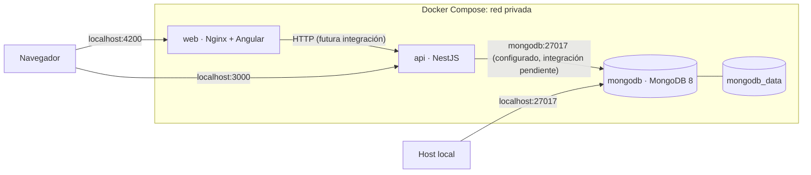

# Arquitectura de SmartLog Analyzer

## Estado y alcance

El monorepo contiene el scaffold generado para NestJS en `src/api` y Angular en `src/web`. La configuración de Docker Compose añade MongoDB y conecta los contenedores a una red privada. **La API todavía no persiste logs ni insights, y no existe aún una integración con un proveedor de IA.** Este documento separa el estado actual de las decisiones objetivo para evitar presentar capacidades pendientes como implementadas.

## Estructura del monorepo

```text
smartlog-analyzer/
├── src/
│   ├── api/                 # API NestJS; lógica de negocio y adaptadores futuros
│   └── web/                 # Interfaz Angular
├── tests/                   # Espacio para pruebas compartidas/de integración
├── db/                      # Espacio para migraciones, índices y seeds
├── Dockerfile               # Builds multi-stage: api y web
├── docker-compose.yml       # Aplicaciones y MongoDB
├── nginx.conf               # Servidor SPA para el target web
├── .env.example             # Configuración local de ejemplo
├── README.md                # Inicio rápido, tests y operación local
└── ARCHITECTURE.md
```

API y frontend son workspaces pnpm. La versión de pnpm se fija en el manifiesto raíz; los manifiestos de cada aplicación mantienen sus dependencias y scripts, mientras que los comandos de raíz coordinan instalación, build y pruebas.

## Diagrama de despliegue



Compose publica la aplicación web en `4200`, la API en `3000` y MongoDB en `27017` por defecto. Los tres valores son configurables desde `.env`. Entre contenedores se usan los nombres de servicio (`mongodb`), no `localhost`. MongoDB almacena sus archivos en el volumen nombrado `mongodb_data`.

## Decisiones para la aplicación

### Ingesta y modelo de log propuesto

La API debería ofrecer endpoints para ingestar y consultar logs. Un log tendrá campos estándar y un identificador de servicio legible y único en formato slug:

```json
{
  "service": "payment-api",
  "timestamp": "2026-11-02T14:00:00.000Z",
  "level": "error",
  "message": "Payment authorization timed out",
  "metadata": {
    "requestId": "..."
  }
}
```

`service` debe validarse como slug y almacenarse en cada documento; esto permite filtrar y agrupar por microservicio sin depender de un catálogo previo. `timestamp`, `level` y `message` representan los datos comunes del evento. El esquema definitivo, límites de tamaño, normalización, retención y estrategia de índices deben acordarse antes de habilitar ingesta de producción.

### Persistencia

MongoDB se eligió para almacenar documentos de log semiestructurados y resultados de análisis asociados. La URI se expone como `MONGODB_URI`, con hostname interno `mongodb` en Compose. El scaffold no incluye todavía un driver/ODM, esquemas, repositorios, índices, migraciones ni seeds. El directorio `db/` queda reservado para las inicializaciones versionadas que se definan.

Modelo lógico sugerido (pendiente de implementar):

- `logs`: campos del evento, `service` slug, fecha de ingesta y metadatos estructurados.
- `analyses`: ventana o conjunto analizado, proveedor/modelo, fecha de ejecución, estado, versión de prompt y hallazgos/insights.
- Relación por referencias o por una ventana temporal y servicios analizados; evitar duplicar mensajes de log en resultados de IA.

### Análisis con IA externa

La integración debe estar detrás de un adaptador de proveedor para desacoplar el dominio de una API/modelo concreto. El flujo previsto es:

1. Seleccionar logs dentro de un rango y filtros de servicio/nivel.
2. Sanitizar o redactar secretos y datos sensibles antes de enviar contenido fuera del sistema.
3. Enviar al proveedor una solicitud acotada y pedir una respuesta estructurada, validada contra un esquema.
4. Persistir proveedor, modelo, estado, timestamps, filtros y resultado en `analyses`.
5. Exponer insights persistidos para consulta y permitir reintentos controlados ante fallos.

No se ha elegido proveedor ni se incluye una API key. La credencial debe llegar por variable secreta en el entorno de despliegue, nunca por el frontend, el código, una imagen Docker o `.env.example`. También quedan pendientes límites de costo/volumen, timeout, manejo de errores, retención y revisión humana de resultados. La IA produce sugerencias, no hechos verificados.

## Docker, puertos y entorno

El Dockerfile contiene targets `api` y `web`, construidos con Node Alpine y Nginx Alpine. El target `api` compila NestJS y usa solo dependencias de producción en la imagen runtime; el target `web` construye Angular y lo sirve con Nginx, incluyendo fallback SPA. `docker-compose.yml` construye ambos targets, inicia MongoDB 8 sobre Ubuntu Noble con volumen persistente y espera el healthcheck de MongoDB antes de iniciar la API. MongoDB usa una imagen oficial basada en Debian/Ubuntu, no Alpine; no hay una imagen Alpine oficial compatible que permita reducirla sin sacrificar compatibilidad.

| Variable | Consumidor | Función |
|---|---|---|
| `API_PORT` | Compose | Puerto de host para NestJS (predeterminado `3000`). |
| `WEB_PORT` | Compose | Puerto de host para Angular/Nginx (predeterminado `4200`). |
| `MONGO_PORT` | Compose | Puerto de host para MongoDB (predeterminado `27017`). |
| `MONGO_INITDB_ROOT_USERNAME` | MongoDB y healthcheck | Usuario inicial administrativo. |
| `MONGO_INITDB_ROOT_PASSWORD` | MongoDB y healthcheck | Contraseña inicial administrativa. |
| `MONGO_DATABASE` | MongoDB | Base de datos inicial configurada. |
| `MONGODB_URI` | API | URI preparada para la conexión de persistencia aún no implementada. |

Los valores de `.env.example` son solo para desarrollo local. La configuración actual no habilita TLS ni políticas de producción para MongoDB; no exponer directamente ese puerto en un entorno compartido.

## Pruebas y evolución

Los tests unitarios/e2e de NestJS y los tests Angular permanecen en sus proyectos. `tests/` puede alojar pruebas de contrato o de integración entre servicios una vez definidos los endpoints. Prioridades siguientes:

1. Definir contratos, validación de entrada y pruebas de ingesta.
2. Implementar conexión MongoDB, repositorios, índices y persistencia de logs.
3. Añadir consulta/paginación y filtros por `service`, nivel y tiempo.
4. Implementar el adaptador de IA, almacenamiento de análisis y manejo de errores/reintentos.
5. Conectar Angular con la API y mostrar patrones/insights.
6. Agregar migraciones/seeds y pruebas integradas con MongoDB.
